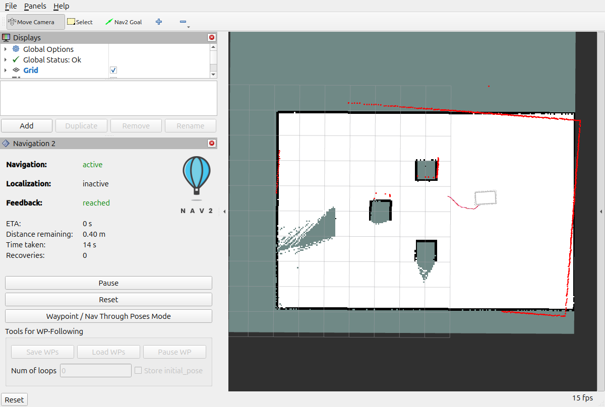

# MiR100 navigation in Gazebo Harmonic

A learning project using ROS 2 Jazzy and the detailed MiR100 model. Click a goal in RViz, plan a grid route with **A***, and follow it using **regulated pure pursuit**. Lidar costmaps and collision checking stop the robot before obstacles; a blocked route is replanned.

## Current status and resolved errors

**Verified in the simulated obstacle room:** consecutive goals at `(6, 0)` and `(6, 2)` both returned Nav2 **SUCCEEDED** with RViz open. The first route went around the obstacle. A third goal sent through the RViz toolbar and mouse drag also returned **SUCCEEDED**. See [repeat-goal results](docs/repeated-goals-test.json) and [test notes](docs/TESTING.md).

- **Sleep-related heartbeat reset:** the earlier controller timeout occurred at `06:59:38`, exactly when the kernel logged resume from sleep. `scripts/run_mir100.sh` now holds a temporary sleep/idle inhibitor while the simulation runs. It releases the inhibitor on exit and does not change persistent power settings.
- **Discovery/readiness after network changes:** the launcher sets `ROS_AUTOMATIC_DISCOVERY_RANGE=LOCALHOST` for this single-laptop simulation. The regression test waits for live sensors, a map, and active controller/navigator states before sending goals.
- **RViz clutter and overhead:** a small RViz view now shows the robot, map, lidar, path, and Nav2 Goal tool at 15 FPS. Unused docking and sensor panels are removed.
- **Remaining non-blocking warning:** RViz may log `active samplers with a different type refer to the same texture image unit` on its first map message. The map has been visually confirmed to render correctly despite that warning; no third-party shader patch is included.
- **Startup TF warnings:** old startup samples may be discarded before transforms are ready. Wait for the map and active navigation. The test checks the live sensor frames before each trip.

The generic Nav2 panel may show **Localization: inactive** because this launch uses SLAM Toolbox rather than AMCL; the `map -> odom` transform is supplied by SLAM.

These results cover the simulated static room. Physical hardware, moving people, and recovery after deliberately forcing the laptop to suspend are not verified. Restart the simulation after deliberate suspend. [The historical heartbeat failure](docs/second-goal-heartbeat-timeout.json) is retained for comparison.

## Install and build

Ubuntu 24.04 with ROS 2 Jazzy and Gazebo Harmonic:

```bash
sudo apt update
sudo apt install ros-jazzy-ros-gz ros-jazzy-navigation2 ros-jazzy-nav2-bringup ros-jazzy-slam-toolbox ros-jazzy-robot-localization ros-jazzy-ros2launch

git clone https://github.com/muffedd/ROS_mir100.git
cd ROS_mir100
source /opt/ros/jazzy/setup.bash
colcon build --symlink-install --base-paths src --packages-select mir_description mir100_navigation
source install/setup.bash
```

## Click a destination

Run from the `ROS_mir100` folder:

```bash
source /opt/ros/jazzy/setup.bash
source install/setup.bash
./scripts/run_mir100.sh
```

The launcher keeps this local simulation awake and independent of Wi-Fi changes. If you use a source-built ROS installation, run `ROS_SETUP="$HOME/ros2_jazzy/install/setup.bash" ./scripts/run_mir100.sh` instead.

1. Wait for the map and active navigation in RViz.
2. Select **Nav2 Goal** from the toolbar.
3. Click free space in the room and drag to select the final heading.
4. Release to send the goal. Click another goal to replace it.

The launch creates a live SLAM map. No fixed goal is sent automatically. The bounded room contains three obstacles. A* chooses a route around mapped obstacles. Pure pursuit turns toward the route and slows for bends. The robot keeps a route until a new goal arrives or the controller reports a blocked path, then replans.

Stop the launch with **Ctrl+C** before starting another instance.

## Save a map

In another terminal, from the workspace root:

```bash
src/mir100_navigation/scripts/save_map.sh
```

This writes `src/mir100_navigation/maps/mir100_world.yaml` and `.pgm`.
Set `ROS_SETUP=/path/to/setup.bash` when using a custom ROS installation.

## Source layout

- `src/mir_description`: robot meshes, Gazebo model, world, and launch files.
- `src/mir100_navigation`: Nav2/SLAM settings, navigation launch, and map saver.

The front lidar bridge has its own frame override. Odometry retains `frame_id=odom`, giving the TF chain `map -> odom -> base_footprint -> front_laser_link`.

## Attribution

MiR100 meshes and original description assets are from DFKI's `mir_robot` project, copyright 2018 DFKI GmbH, under the BSD license retained in `src/mir_description/LICENSE`. The repository's existing root license is retained.

## Verified run

The 6 m goal test completed with Nav2 status **SUCCEEDED** after routing around the box. See [test notes](docs/TESTING.md) and [recorded progress](docs/navigation-test.json).

## Repeat the navigation check

While the simulation is running, in another terminal:

```bash
source /opt/ros/jazzy/setup.bash
source install/local_setup.bash
ROS_AUTOMATIC_DISCOVERY_RANGE=LOCALHOST python3 scripts/test_navigation.py --goals 6,0 6,2
```

The script verifies live sensor frames and active lifecycle states, then checks each action's terminal status. It exits unsuccessfully if a goal is rejected, aborted, or times out.


